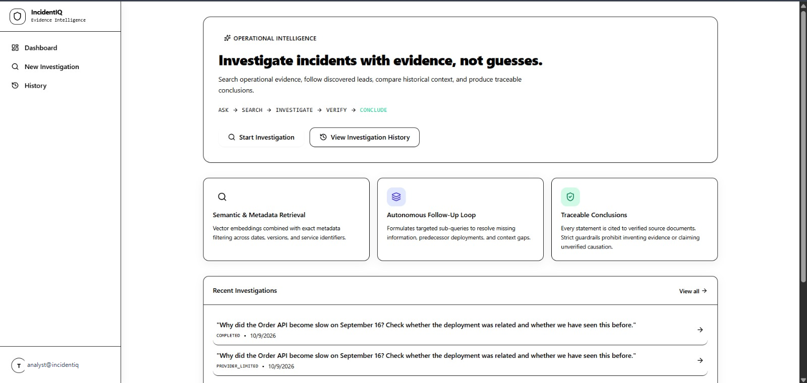
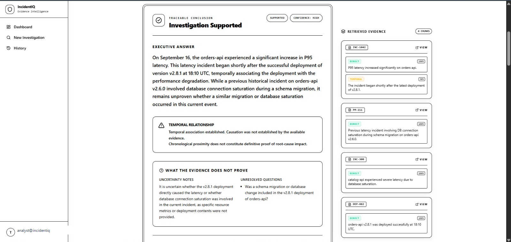
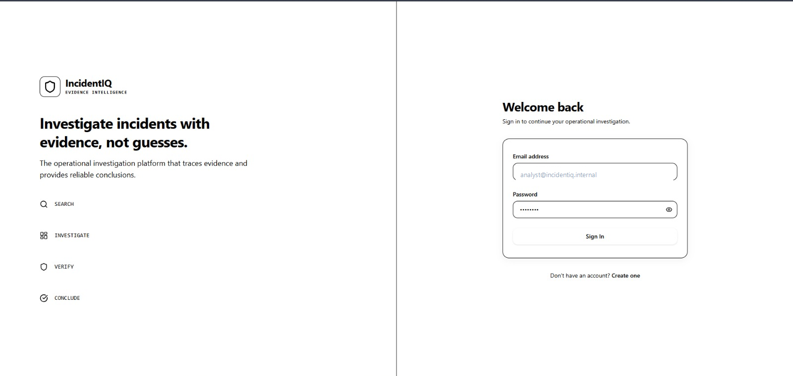
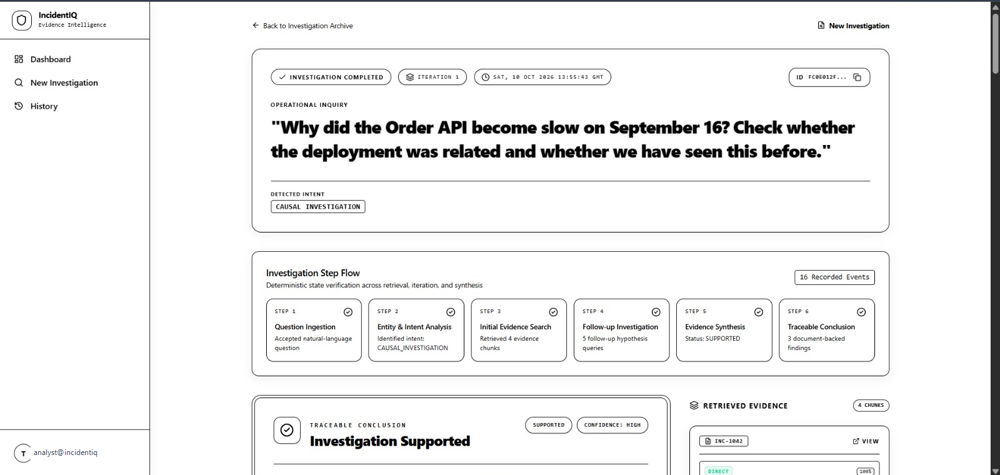
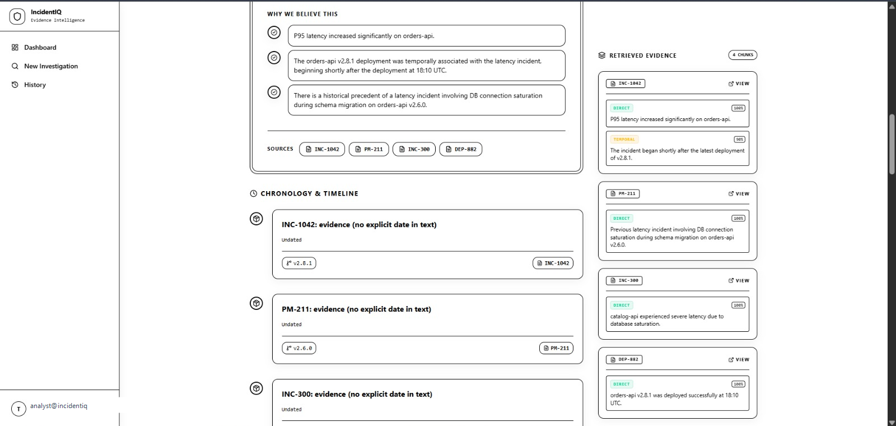
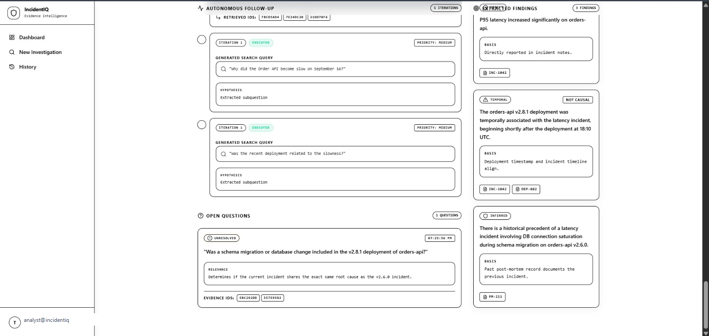
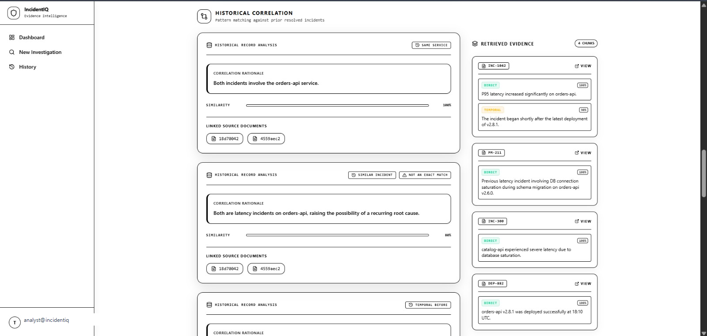
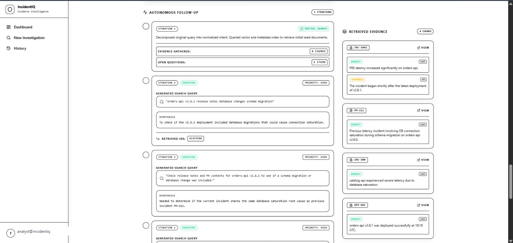
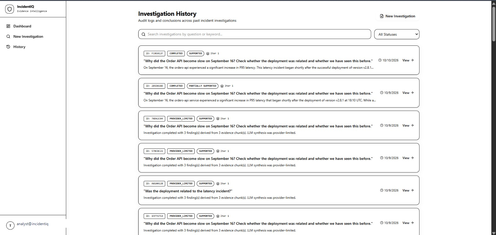
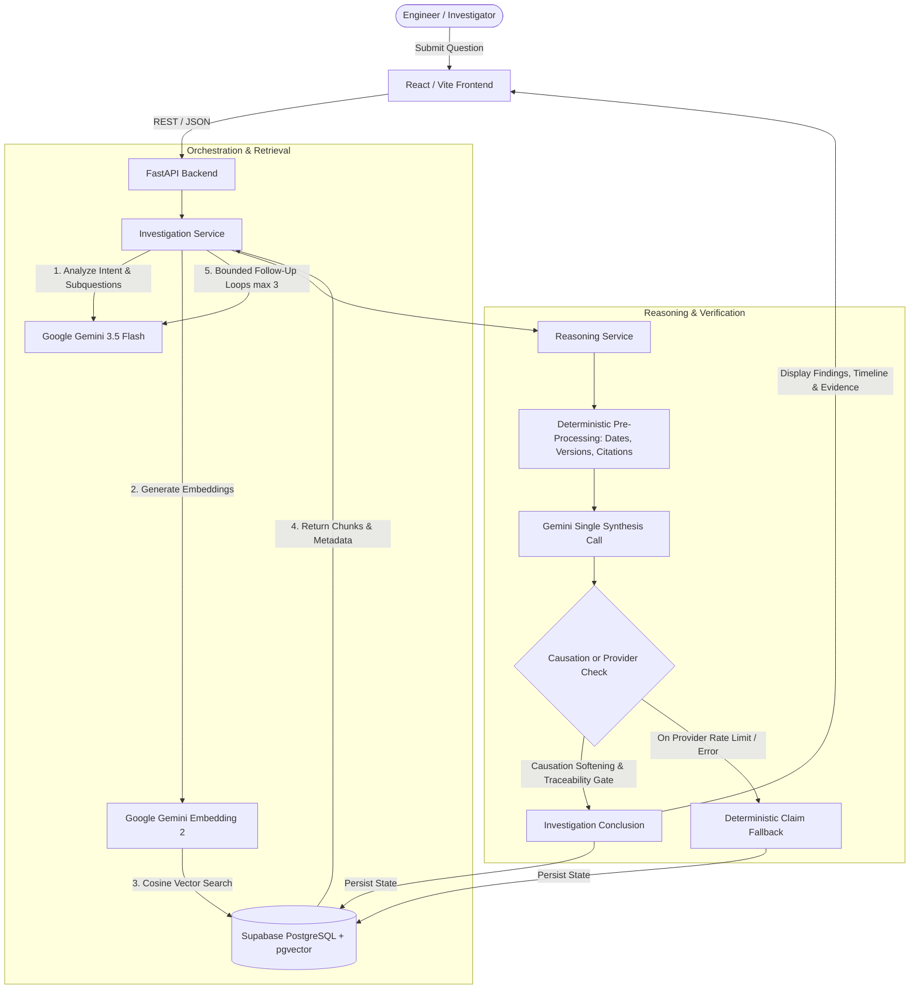

# IncidentIQ
### Evidence-Backed Operational Incident Investigation

IncidentIQ is an AI-powered operational incident investigation and evidence-intelligence platform designed for modern engineering organizations. When high-severity outages occur, critical operational evidence is fragmented across multiple disparate silos—incident postmortems, deployment changelogs, architecture manuals, service-level runbooks, and telemetry logs. On-call engineers and reliability leaders are forced to manually correlate timestamps, navigate conflicting troubleshooting recommendations, and risk conflating simple temporal coincidence with genuine root causation.

IncidentIQ addresses this challenge by functioning as an evidence-grounded investigation system rather than a generic conversational chatbot or simple document summarizer. Given a natural-language operational inquiry, the platform decomposes the problem into targeted subquestions, executes bounded hybrid retrieval (combining pgvector semantic embeddings with structured metadata filtering), extracts verifiable claims tied directly to source document chunks, evaluates chronology and software version applicability, and detects contradictions across operational guidance.

The resulting findings are synthesized into an audit-ready, traceable investigation conclusion. If the corpus contains conflicting instructions, IncidentIQ highlights both perspectives with their respective operating contexts. If the retrieved evidence is insufficient to prove causation or answer the inquiry, IncidentIQ explicitly reports an insufficient-evidence outcome rather than hallucinating unsubstantiated answers.

---

## Live Demo & Production Endpoints

IncidentIQ is deployed in production across a multi-tier cloud infrastructure:

- **Live Web Application (Frontend)**: [https://incident-iq-sandy.vercel.app](https://incident-iq-sandy.vercel.app/)
- **Interactive API Documentation (Swagger)**: [https://incidentiq-api-8t78.onrender.com/docs](https://incidentiq-api-8t78.onrender.com/docs)
- **API Health & Service Probe**: [https://incidentiq-api-8t78.onrender.com/health](https://incidentiq-api-8t78.onrender.com/health)
- **Source Code Repository**: [https://github.com/SiddarthThota/IncidentIQ](https://github.com/SiddarthThota/IncidentIQ)

### Cloud Deployment Architecture

- **Frontend (Vercel)**: React 19 / TypeScript single-page application built with Vite and Tailwind CSS v4, deployed globally on Vercel's Edge Network.
- **Backend (Render)**: Python 3.13 / FastAPI asynchronous service running as a containerized web service on Render, providing REST APIs, CORS middleware, and orchestration logic.
- **Database & Authentication (Supabase)**: Managed PostgreSQL 15 database with the `pgvector` extension for 1536-dimensional vector similarity search, Row Level Security (RLS), and JWT authentication.
- **AI & Embedding Models (Google Cloud GenAI)**: `gemini-3.5-flash` for operational intent decomposition and reasoning synthesis; `gemini-embedding-2` for 1536-dimensional semantic chunk embeddings.

---

## Key Capabilities

- **Natural-Language Operational Inquiries**: Formulates and decomposes complex technical questions into structured investigation subquestions and target entities.
- **Hybrid Semantic & Metadata-Aware Retrieval**: Combines pgvector cosine similarity search (`gemini-embedding-2`, 1536 dimensions) with strict SQL metadata filtering across service names, document types, software versions, and dates.
- **Multi-Document Evidence Exploration**: Discovers and associates facts across disparate document types, including incident reports (`incident_report`), deployment notes (`deployment_note`), postmortems (`postmortem`), and runbooks (`troubleshooting`).
- **Bounded Iterative Follow-Up Search**: Dynamically generates targeted follow-up queries based on discovered evidence gaps and unresolved questions, bounded to a maximum of 3 iterations and 2 queries per cycle to prevent runaway execution.
- **Traceable Evidence Classification**: Classifies every extracted claim (`DIRECT`, `CORROBORATED`, `TEMPORAL`, `INFERRED`, `CONTRADICTED`, `INSUFFICIENT`) with direct UUID linkage back to the exact chunk and parent document.
- **Chronological & Version Reasoning**: Separates real-world event dates from document publication timestamps, organizing evidence into strict temporal sequences alongside software versions.
- **Contradiction Preservation**: Identifies and surfaces conflicting operational recommendations (such as legacy restart advice versus modern dependency-safe practices) side-by-side rather than arbitrarily picking one.
- **Similar vs. Exact Historical Matching**: Evaluates historical incidents across symptom, service, failure mode, and context to identify actionable patterns without falsely declaring identical root causes.
- **Evidence-Backed Conclusions & Uncertainty Disclosures**: Produces executive conclusions with explicit confidence ratings (`HIGH`, `MEDIUM`, `LOW`), clear status classifications (`SUPPORTED`, `PARTIALLY_SUPPORTED`, `INSUFFICIENT`, `CONTRADICTED`, `PROVIDER_LIMITED`), and prominent causation boundary warnings.
- **Persistent Investigation Audit Trail**: Stores full investigation state—including initial questions, retrieved chunks, extracted claims, relationship graphs, event sequences, and conclusions—in Supabase PostgreSQL.
- **Authentication & History Management**: Manages access boundaries via Supabase Auth and maintains searchable, filterable history of past investigations.
- **Resilient Provider Failure Handling**: Features deterministic fallbacks that safely preserve evidence and extract raw factual claims with low confidence ratings whenever cloud LLM APIs experience rate limits, quota exhaustion, or service interruptions.

---

## Product Screenshots

### Primary Visual Highlights

#### 1. Operations Dashboard

*The primary IncidentIQ dashboard showcasing system telemetry, operational intelligence shortcuts, rapid investigation starters, and recent inquiry status audit trails.*

#### 2. Traceable Conclusion & Causation Warning

*Traceable conclusion panel for the Order API incident (`INC-1042`), featuring an executive answer, strict amber causation boundary warning, uncertainty notes, and direct citations to retrieved evidence chunks.*

---

<details open>
<summary><strong>View Complete 9-Screen Investigation Gallery</strong> (Click to expand or collapse)</summary>
<br />

### Authentication and Dashboard

#### Sign-In & Access Boundary

*Secure authentication gateway providing user identity segregation and protected API session management via Supabase Auth.*

#### Operations Hub

*The central operational workspace providing inquiry entry points, rapid incident starters, and recent investigation histories.*

### Investigation Workflow

#### Six-Stage Deterministic Progress Flow

*Deterministic 6-stage step progression (Question Ingestion, Intent Analysis, Evidence Search, Follow-Up Search, Synthesis, Conclusion) tracking live inquiry execution with event counters.*

### Evidence and Traceable Conclusions

#### Traceable Conclusion Panel

*Executive conclusion panel highlighting proven findings alongside prominent amber causation boundary warnings and uncertainty disclosures.*

#### Chronology & Timeline View

*Strict chronological event ordering mapping incidents (`INC-1042`), deployments (`DEP-882`), and postmortems (`PM-211`) by explicit event dates alongside retrieved chunk citations.*

#### Extracted Claims & Open Questions

*Atomic factual claim cards with confidence ratings and classification badges (`TEMPORAL`, `DIRECT`, `INFERRED`) alongside open inquiry tracking.*

### Historical Comparison and Autonomous Follow-up

#### Historical Pattern Matcher

*Context-aware pattern matcher correlating past incidents (e.g., database saturation on `v2.6.0`) as Similar Incidents without falsely declaring identical root causes.*

#### Autonomous Follow-Up Cycles

*Multi-iteration follow-up loops dynamically formulating targeted hypothesis queries to resolve missing information and predecessor deployments.*

### Investigation History

#### Historical Audit Archive

*Comprehensive historical investigation archive with keyword search, conclusion status filters (`SUPPORTED`, `PARTIALLY_SUPPORTED`, `PROVIDER_LIMITED`), and direct links to past investigation states.*

</details>

---

## Example Investigation

Consider the canonical operational challenge question:

> *"Why did the Order API become slow on September 16? Check whether the deployment was related and whether we have seen this before."*

In a standard IncidentIQ knowledge base seeded with internal operational records, the system identifies and connects the following core documents:

1. **`INC-1042` (Incident Report)**:
   - **Service**: `orders-api` | **Version**: `v2.8.1` | **Date**: `2026-09-16`
   - **Evidence**: Documents that P95 latency increased significantly on `orders-api`, starting shortly after the latest deployment of `v2.8.1`.
2. **`DEP-882` (Deployment Record)**:
   - **Service**: `orders-api` | **Version**: `v2.8.1` | **Date**: `2026-09-15`
   - **Evidence**: Confirms that `orders-api` version `v2.8.1` was deployed to production at 18:10 UTC on September 15.
3. **`PM-211` (Historical Postmortem)**:
   - **Service**: `orders-api` | **Version**: `v2.6.0` | **Date**: `2026-05-03`
   - **Evidence**: Details a prior latency incident on `orders-api` caused by database connection saturation during a schema migration on `v2.6.0`.

### The Epistemic Boundary: Temporal Association vs. Causation

IncidentIQ connects `INC-1042` and `DEP-882` chronologically, establishing that deployment `DEP-882` temporally preceded the latency spike reported in `INC-1042`. However, the system's reasoning engine enforces a strict boundary:

> **Temporal precedence is not causal proof.** The fact that `DEP-882` occurred prior to `INC-1042` does not inherently prove that the deployment introduced the defect. Furthermore, while `PM-211` describes a historical incident on the same service with similar latency symptoms, it occurred on an older software version (`v2.6.0`) during a database schema migration. IncidentIQ highlights this as a **Similar Incident**, not an exact match.

---

## How IncidentIQ Works



### The 7-Step Investigation Workflow

1. **Question Submission**: The user submits an operational inquiry via the web dashboard.
2. **Question Analysis & Decomposition**: The backend analyzes the question's operational intent (`TROUBLESHOOTING`, `CAUSAL_INVESTIGATION`, `HISTORICAL_COMPARISON`, etc.) and extracts up to 3 focused subquestions.
3. **Hybrid Chunk Retrieval**: The system generates vector embeddings (1536-dimensional) and invokes the Supabase `match_document_chunks` RPC function to search document chunks using cosine similarity and metadata filters.
4. **Evidence Extraction & Deduplication**: Extracted chunks are deduplicated against prior findings and assigned unique evidence identifiers. Factual claims are extracted and tied to chunk UUIDs.
5. **Bounded Follow-Up Queries**: Unresolved questions spawn targeted follow-up searches across bounded iterative cycles (capped at 3 iterations and 2 queries per cycle).
6. **Deterministic Reasoning & Synthesis**:
   - Deterministic Python algorithms build event timelines from explicit text dates and resolve source references.
   - Contradictions across documents are cross-referenced and preserved.
   - A single bounded LLM synthesis call compiles findings, softens unproven causal phrasing, and flags unresolved questions.
   - If the LLM provider is unavailable or rate-limited, deterministic fallbacks generate baseline claims and mark the state as `PROVIDER_LIMITED`.
7. **Frontend Visualization**: The React interface presents an executive conclusion summary, causation warnings, chronological timeline, contradiction matrix, and expandable source document drawers.

### Deterministic Code vs. LLM Responsibilities

| Responsibility | Handled By | Rationale |
| :--- | :--- | :--- |
| **UUIDs & Entity Identifiers** | Deterministic (Python/SQL) | Guarantees non-hallucinated document and evidence references. |
| **Vector Similarity Calculation** | Deterministic (`pgvector` RPC) | Performs mathematical cosine distance ranking in PostgreSQL. |
| **Iteration Limits & Cycle Bounds** | Deterministic (Python) | Enforces strict termination (max 3 iterations) to prevent infinite loops. |
| **Date & Version Extraction** | Deterministic (Regex / Parser) | Normalizes chronological dates and semver tags without creative interpretation. |
| **Causation Language Softening** | Deterministic (Regex Guardrails) | Intercepts unsupported causal terms (`caused by`, `resulted from`) and rewrites to temporal language. |
| **Natural Language Understanding** | LLM (`gemini-3.5-flash`) | Interprets semantic nuances, ambiguous operational terminology, and inquiry intents. |
| **Claim Formulation & Synthesis** | LLM (`gemini-3.5-flash`) | Summarizes multi-document findings into concise technical statements. |

---

## Technology Stack

### Frontend
- **Framework**: React 19 (`react`, `react-dom`)
- **Language**: TypeScript (`typescript` ~6.0.2)
- **Tooling & Bundler**: Vite 8 (`vite`, `@vitejs/plugin-react`)
- **Styling**: Tailwind CSS v4 (`tailwindcss`, `@tailwindcss/vite`, `clsx`, `tailwind-merge`)
- **Icons**: Lucide React (`lucide-react`)
- **Routing**: React Router v7 (`react-router-dom`)
- **Server State & Caching**: TanStack Query v5 (`@tanstack/react-query`)
- **Testing**: Vitest (`vitest`), React Testing Library (`@testing-library/react`), JSDOM (`jsdom`), Oxlint (`oxlint`)

### Backend
- **Framework**: FastAPI (`fastapi`)
- **ASGI Server**: Uvicorn (`uvicorn`)
- **Data Validation & Settings**: Pydantic v2 (`pydantic`), Pydantic Settings (`pydantic-settings`)
- **Language**: Python 3.13+
- **Environment Management**: `python-dotenv`
- **Testing**: Pytest (`pytest`, `pytest-asyncio`, `anyio`), FastAPI TestClient (`httpx`)

### AI & Embeddings
- **SDK**: Official Google GenAI SDK (`google-genai`)
- **Reasoning Model**: `gemini-3.5-flash` (configurable via `LLM_MODEL`)
- **Embedding Model**: `gemini-embedding-2` (1536 output dimensions, configurable via `EMBEDDING_MODEL` and `EMBEDDING_DIMENSION`)
- **Fallback Compatibility**: OpenAI client structure supported via configuration (`OPENAI_API_KEY`)

### Database & Authentication
- **Platform**: Supabase
- **Database Engine**: PostgreSQL 15+
- **Vector Search**: PostgreSQL `pgvector` extension
- **Auth**: Supabase Auth (Bearer JWT validation boundary)
- **Data Access**: `supabase-py` client and PostgREST RPC endpoints

### Deployment
- **Frontend Hosting**: Vercel Edge Network
- **Backend Hosting**: Render Container Service
- **Database Hosting**: Supabase Managed Cloud

---

## Architecture and Project Structure

```text
IncidentIQ/
├── backend/
│   ├── app/
│   │   ├── api/
│   │   │   ├── deps.py               # Dependency injection & JWT auth verification
│   │   │   └── endpoints/
│   │   │       ├── documents.py      # /api/documents (list, get, ingest)
│   │   │       ├── investigations.py  # /api/investigations (create, list, get, conclude)
│   │   │       └── search.py         # /api/search (vector similarity & metadata search)
│   │   ├── core/
│   │   │   ├── config.py             # Pydantic BaseSettings environment validation
│   │   │   └── logger.py             # Safe structured logging (credential masking)
│   │   ├── repositories/
│   │   │   ├── conclusion_repo.py    # Persistence for investigation conclusions & findings
│   │   │   ├── document_repo.py      # Persistence for documents and chunks
│   │   │   ├── investigation_repo.py # Persistence for investigation state & event logs
│   │   │   └── search_repo.py        # Supabase RPC pgvector execution
│   │   ├── schemas/
│   │   │   ├── conclusion.py         # Pydantic schemas for conclusions & timeline events
│   │   │   ├── document.py           # Pydantic schemas for documents & ingestion payloads
│   │   │   ├── investigation.py      # State, analysis, evidence, and event schemas
│   │   │   └── search.py             # Vector search request & response models
│   │   └── services/
│   │       ├── embedding_service.py  # Google GenAI embedding generation (1536-dim)
│   │       ├── ingestion_service.py  # Text chunking, validation, and storage pipeline
│   │       ├── investigation_service.py # Iterative loop orchestration & follow-ups
│   │       ├── llm_service.py        # Structured JSON generation with Google GenAI
│   │       ├── reasoning_service.py  # Deterministic analysis, synthesis, & causation gates
│   │       ├── retrieval_service.py  # Hybrid search execution & ranking
│   │       └── supabase_client.py   # Client lifecycle & connection management
│   ├── scripts/
│   │   ├── apply_migration.py       # Standalone migration applicator utility
│   │   ├── live_verify.py           # Verification script for live database checks
│   │   └── seed_corpus.py           # Controlled seeder for the 7 demonstration documents
│   ├── tests/                       # Unit & integration test suite (54 mocked tests)
│   ├── main.py                      # FastAPI application entrypoint & middleware
│   └── requirements.txt             # Backend Python dependencies
├── frontend/
│   ├── src/
│   │   ├── components/
│   │   │   ├── investigation/       # Investigation detail views (Timeline, Findings, etc.)
│   │   │   └── layout/              # Responsive AppLayout and navigation
│   │   ├── contexts/
│   │   │   └── AuthContext.tsx      # Supabase authentication session context
│   │   ├── lib/
│   │   │   ├── api.ts               # Unified API client with Supabase fallback
│   │   │   └── supabase.ts          # Supabase client instantiation
│   │   ├── pages/                   # Application views (Dashboard, History, etc.)
│   │   ├── test/                    # Frontend Vitest test suite (16 tests)
│   │   └── types/                   # TypeScript interfaces matching backend contracts
│   ├── package.json                 # Frontend dependencies and npm scripts
│   └── vite.config.ts               # Vite bundler and Vitest configuration
├── docs/
│   └── assets/
│       └── screenshots/             # 9 production UI screenshots with sanitized credentials
├── screenshots-source/              # Original unprocessed capture files (unaltered)
├── supabase/
│   └── migrations/                  # 7 SQL migrations for tables, indexes, and RPCs
├── AGENTS.md                        # Permanent rules for AI and developer contributors
├── ARCHITECTURE.md                  # System architecture blueprint
├── CURRENT_PHASE.md                 # Project phase tracking and checkpoint log
├── EVALUATOR_TEST_GUIDE.md          # Evaluation test guide for hackathon reviewers
├── HACKATHON_DAY_RUNBOOK.md         # Operational runbook
├── IMPLEMENTATION.md                # Phase-by-phase implementation plan
└── README.md                        # Project documentation
```

### Module Responsibilities & Flow

- **API Layer (`backend/app/api/endpoints/`)**: Exposes REST endpoints, validates HTTP request structures with Pydantic schemas, and injects service dependencies.
- **Service Layer (`backend/app/services/`)**: Implements application business logic. `InvestigationService` drives iterative question decomposition and retrieval, while `ReasoningService` coordinates deterministic timeline extraction and synthesis.
- **Repository Layer (`backend/app/repositories/`)**: Encapsulates all data access logic for Supabase PostgreSQL tables and RPC procedures.
- **Schema Layer (`backend/app/schemas/`)**: Declares strict data contracts shared between services and API endpoints.
- **Frontend Layer (`frontend/src/`)**: Renders reactive UI workspaces. `frontend/src/lib/api.ts` orchestrates HTTP requests to the FastAPI backend, falling back gracefully to direct Supabase queries if the backend is unreachable for historical reads.
- **Database Layer (`supabase/migrations/`)**: Manages the PostgreSQL schema, indexes on vector embeddings, and the custom `match_document_chunks` RPC function.

---

## Installation and Local Development

### Prerequisites

- Python 3.13 or higher
- Node.js 18.x or higher (Node 20+ recommended)
- npm 9.x or higher
- A Supabase project with `pgvector` enabled
- A valid Google Gemini API key

### 1. Backend Setup

Open a terminal (PowerShell on Windows or Bash on macOS/Linux) and navigate to the `backend` directory:

```bash
cd backend
python -m venv venv
```

**Activate the virtual environment**:

On Windows PowerShell:
```powershell
.\venv\Scripts\Activate.ps1
```

On macOS / Linux:
```bash
source venv/bin/activate
```

**Install dependencies**:
```bash
python -m pip install -r requirements.txt
```

**Configure Environment Variables**:
Create a `.env` file in the `backend/` directory based on `backend/.env.example`:
```bash
cp .env.example .env
```
*(Populate your API keys and database credentials as detailed in the Environment Configuration section).*

**Start the FastAPI Development Server**:
```bash
python -m uvicorn main:app --reload --host 127.0.0.1 --port 8000
```

Verify backend health by visiting:
- Health check: [http://127.0.0.1:8000/health](http://127.0.0.1:8000/health)
- Interactive API Docs (Swagger): [http://127.0.0.1:8000/docs](http://127.0.0.1:8000/docs)

*(Keep this terminal open).*

### 2. Frontend Setup

Open a second terminal and navigate to the `frontend` directory:

```bash
cd frontend
npm install
```

**Configure Environment Variables**:
Create a `.env` file in the `frontend/` directory based on `frontend/.env.example`:
```bash
cp .env.example .env
```
*(Populate your Supabase URL and Publishable Key).*

**Start the Vite Development Server**:
```bash
npm run dev
```

Open your browser and navigate to:
- Application UI: [http://localhost:5173](http://localhost:5173)

*(Keep this terminal open alongside the backend terminal).*

---

## Environment Configuration

IncidentIQ cleanly separates private server credentials from client-facing variables. Never commit `.env` files to source control.

### Backend Configuration (`backend/.env`)

| Variable Name | Required | Default Value | Description |
| :--- | :--- | :--- | :--- |
| `SUPABASE_URL` | **Yes** | — | Supabase project REST API endpoint URL (e.g., `https://xyz.supabase.co`). |
| `SUPABASE_SECRET_KEY` | **Yes** | — | Supabase `service_role` secret key for backend database operations and RLS bypass. |
| `GEMINI_API_KEY` | **Yes** | — | Google Gemini API key for structured text synthesis and embeddings. |
| `OPENAI_API_KEY` | No | `None` | Optional OpenAI key for secondary fallback provider configurations. |
| `LLM_MODEL` | No | `gemini-3.5-flash` | Gemini model identifier used for analysis and synthesis. |
| `EMBEDDING_MODEL` | No | `gemini-embedding-2` | Gemini model identifier used for vector embeddings. |
| `EMBEDDING_DIMENSION` | No | `1536` | Embedding vector output dimension. Must match pgvector schema definition. |
| `FRONTEND_URL` | No | `http://localhost:5173` | Allowed origin for FastAPI Cross-Origin Resource Sharing (CORS) headers. |

### Frontend Configuration (`frontend/.env`)

| Variable Name | Required | Default Value | Description |
| :--- | :--- | :--- | :--- |
| `VITE_SUPABASE_URL` | **Yes** | — | Public Supabase project URL for browser client authentication. |
| `VITE_SUPABASE_PUBLISHABLE_KEY` | **Yes** | — | Public `anon` / publishable key for browser authentication requests. |
| `VITE_API_URL` | No | `http://localhost:8000` | IncidentIQ FastAPI backend base URL. **Must be set to the production backend URL in hosted environments.** |

> [!SECURITY NOTE]
> All variables prefixed with `VITE_` are bundled directly into public client-side JavaScript. Never place `SUPABASE_SECRET_KEY` or `GEMINI_API_KEY` in `frontend/.env`.

---

## Database and Retrieval

### Schema & Data Model

IncidentIQ structures operational knowledge across specialized PostgreSQL tables:

- **`documents`**: Metadata for ingested operational documents (`source`, `title`, `document_type`, `service`, `document_date`, `software_version`).
- **`document_chunks`**: Segmented document passages with attached 1536-dimensional `vector` embeddings and JSON metadata.
- **`investigations`**: Top-level records of inquiries, tracking status, iteration counts, and timestamps.
- **`investigation_events`**: Chronological event audit log tracking query execution, evidence discovery, and error states.
- **`investigation_evidence`**: Retrieved chunks associated with a specific investigation.
- **`evidence_claims`**: Atomic factual propositions extracted from chunks with classifications (`DIRECT`, `CORROBORATED`, `TEMPORAL`, etc.) and confidence scores.
- **`investigation_relationships`**: Semantic and causal connections between evidence chunks.
- **`investigation_contradictions`**: Documented conflicts between opposing guidance chunks.
- **`investigation_open_questions`**: Questions generated during investigation to drive follow-up iterations.
- **`investigation_follow_up_queries`**: Exact search strings executed during iterative cycles.
- **`investigation_conclusions`**: Final synthesized reports, overall confidence ratings, and uncertainty disclosures.
- **`investigation_findings`**: Individual conclusion statements linked directly to chunk IDs and parent documents.
- **`timeline_events`**: Chronologically sorted real-world incident events.

### Vector Search via PostgreSQL RPC

Vector similarity queries execute through the custom PostgreSQL function `match_document_chunks`:

```sql
SELECT * FROM match_document_chunks(
    query_embedding := <1536-dim vector>,
    match_threshold := 0.20,
    match_count := 5,
    filter_document_type := 'incident_report',
    filter_service := 'orders-api',
    filter_version := 'v2.8.1'
);
```

### Seeding Example Corpus Documents

The repository includes a controlled seeding script (`backend/scripts/seed_corpus.py`) that safely ingests the 7 canonical test documents (`INC-1042`, `DEP-882`, `PM-211`, `GUIDE-12`, `GUIDE-41`, `INC-300`, `INC-301`) into a configured database:

```bash
cd backend
python scripts/seed_corpus.py
```

> [!CAUTION]
> Do not execute reset scripts or blind re-seeding against production databases without backing up existing records.

---

## Running Tests

IncidentIQ maintains rigorous unit, integration, and build validation suites.

### Backend Tests

Backend tests verify API schemas, CORS policies, error masks, retrieval deduplication, deterministic timeline sorting, causation phrase softening, and LLM fallback paths.

> [!NOTE]
> Backend unit tests execute against mocked dependencies to provide 100% reproducible, deterministic CI validation without consuming external cloud API quotas.

```powershell
cd backend
.\venv\Scripts\python.exe -m pytest tests/test_foundation.py tests/test_documents.py tests/test_retrieval.py tests/test_investigation.py tests/test_reasoning.py tests/test_llm_service.py -v
```

**Results**:
```text
======================== 54 passed in ~0.50s ========================
```

*(Note: Live end-to-end integration tests in `test_live_phase2.py` and `test_live_phase4.py` are explicitly marked with `@pytest.mark.skip` to prevent unwanted live quota drain and slow CI runs).*

### Frontend Tests

Frontend tests verify React components, status banners, timeline renderings, contradiction matrices, causation warnings, and authentication screens using Vitest:

```bash
cd frontend
npm run test
```

**Results**:
```text
 ✓ src/test/investigation.test.tsx (16 tests)
 Test Files  1 passed (1)
      Tests  16 passed (16)
```

### Production Build Validation

To verify TypeScript types and package bundling:

```bash
cd frontend
npm run build
```

**Results**:
```text
✓ 2017 modules transformed.
dist/index.html                   0.45 kB
dist/assets/index-*.css          59.48 kB
dist/assets/index-*.js          621.91 kB
✓ built cleanly
```

---

## Deployment

IncidentIQ is deployed across a low-friction multi-cloud architecture:

```text
Browser Client
     │
     ▼
Vercel (React / TypeScript SPA)
     │
     │ HTTPS / REST (VITE_API_URL)
     ▼
Render (FastAPI Python Service)
     ├── Supabase (PostgreSQL 15 + pgvector + Supabase Auth)
     └── Google Gemini API (gemini-3.5-flash & gemini-embedding-2)
```

### Production Setup Requirements

1. **Frontend (Vercel)**:
   - Deploy `frontend/` as a Vite / React project.
   - Configure Environment Variables:
     - `VITE_SUPABASE_URL`: Production Supabase URL.
     - `VITE_SUPABASE_PUBLISHABLE_KEY`: Production Supabase anon key.
     - `VITE_API_URL`: `https://incidentiq-api-8t78.onrender.com`.
2. **Backend (Render)**:
   - Deploy `backend/` as a Python web service (Root Directory: `backend`, Start Command: `uvicorn main:app --host 0.0.0.0 --port $PORT`).
   - Configure Environment Variables:
     - `SUPABASE_URL`: Production Supabase URL.
     - `SUPABASE_SECRET_KEY`: Production Supabase service role key.
     - `GEMINI_API_KEY`: Production Google Gemini API key.
     - `FRONTEND_URL`: `https://incident-iq-sandy.vercel.app` (to authorize CORS headers).
3. **Supabase Project**:
   - Set Site URL and Redirect URLs in Supabase Auth to `https://incident-iq-sandy.vercel.app`.

---

## Reliability and Limitations

- **Gemini API Quota & Rate Limits**: Free and standard tier Gemini API accounts enforce Requests-Per-Minute (RPM) and Tokens-Per-Minute (TPM) limits. Under rapid sequential querying, provider throttling may occur. Live AI reasoning success is subject to active provider availability and account quota limits.
- **Deterministic Fallback Behavior**: When Gemini calls fail or encounter rate limits, IncidentIQ automatically transitions the investigation to `PROVIDER_LIMITED`. In this state, evidence is strictly preserved and atomic claims are derived using deterministic sentence segmentation with low confidence (`LOW`). While this maintains full source traceability and prevents platform crashes, fallback claims lack the full semantic synthesis of an active LLM call.
- **Similarity vs. Identity**: The system actively prevents false equivalence: an incident matching the same service and symptoms as a historical ticket is categorized as a **Similar Incident**, never an exact duplicate, unless all variables (including version, environment, and trigger) match.
- **Temporal Association vs. Causation**: Coinciding dates and deployment precedence do not prove causation. The reasoning layer actively softens causal assertions and flags temporal links.
- **Insufficient Evidence as a Valid Outcome**: If an operational question cannot be answered from the available corpus, IncidentIQ returns `INSUFFICIENT` rather than extrapolating speculative conclusions. Zero-hallucination is an engineered optimization target rather than an unconditional mathematical guarantee.

---

## Security

- **Strict Credential Segregation**: The frontend bundle never receives backend service-role credentials or AI provider API keys.
- **Authentication Boundary**: Protected API routes require a valid Supabase JWT Bearer token passed via HTTP Authorization headers.
- **Anti-Hallucination Evidence Gate**: Conclusions cannot introduce arbitrary document identifiers. Any finding lacking verifiable linkage to a retrieved chunk ID is automatically downgraded to `INFERRED` with a low confidence rating.
- **Safe Error Masking**: Unhandled exceptions in the FastAPI application are intercepted by a global exception handler, returning generic `500 Internal Server Error` details to clients while recording sanitized diagnostic traces on the server.

---

## Evaluation and Demo Guide

For evaluators and recruiters reviewing IncidentIQ, follow this sequence:

1. **Sign In**: Navigate to the live demo at [https://incident-iq-sandy.vercel.app](https://incident-iq-sandy.vercel.app/) and sign in or explore the pre-authenticated workspace.
2. **Start Investigation (Test A)**:
   - Enter the benchmark inquiry:
     > *"Why did the Order API become slow on September 16? Check whether the deployment was related and whether we have seen this before."*
   - Click **Run Investigation**.
3. **Inspect Evidence & Follow-Up Search**:
   - Observe the multi-stage progress indicator as the system analyzes intent and executes bounded follow-up searches.
   - Review retrieved chunks from `INC-1042`, `DEP-882`, and `PM-211`.
4. **Examine Chronology & Causation Boundary**:
   - Open the **Investigation Timeline** view to observe the separation between event timestamps and document dates.
   - Review the amber **Causation Boundary Warning**, highlighting that `DEP-882` preceded the incident but does not establish proven causation.
5. **Review Historical Incident Comparison**:
   - Inspect the **Historical Comparison** panel to verify how `PM-211` is correctly identified as a *Similar Incident* (database saturation on `v2.6.0`), preserving the distinction from the current incident (`v2.8.1`).
6. **Test Conflicting Operational Guidance (Test B)**:
   - Submit: *"The service is failing after a deployment. What should the on-call engineer do first?"*
   - Inspect the **Contradictions Matrix** comparing `GUIDE-12` (legacy restart instruction) against `GUIDE-41` (modern dependency-first guidance preventing thundering herd).
7. **Test Insufficient Evidence (Test C)**:
   - Submit an inquiry regarding an unindexed service or unrelated topic (e.g., *"What caused the authentication outage in the payments-auth cluster on July 4th?"*).
   - Observe the system produce an explicit `INSUFFICIENT` conclusion status without hallucinations.

---

## API Overview

| Method | Endpoint | Description | Auth Requirement |
| :--- | :--- | :--- | :--- |
| `GET` | `/health` | Application status, Supabase connectivity, and config probe | Public |
| `POST` | `/api/investigations` | Submit a question to initiate an investigation and generate a conclusion | Public / Bearer Token |
| `GET` | `/api/investigations` | List historical investigations with status, confidence, and summaries | Public / Bearer Token |
| `GET` | `/api/investigations/{id}` | Retrieve full persisted state and conclusion for an investigation | Public / Bearer Token |
| `POST` | `/api/investigations/{id}/conclude` | Re-run or trigger reasoning on an existing investigation record | Public / Bearer Token |
| `POST` | `/api/search` | Search document chunks via pgvector embeddings & metadata filters | Public / Bearer Token |
| `GET` | `/api/documents` | List operational documents indexed in the knowledge base | Bearer Token Required |
| `GET` | `/api/documents/{id}` | Retrieve detailed document metadata and contents by UUID | Bearer Token Required |
| `POST` | `/api/documents/ingest` | Chunk, embed, and index a new document into the knowledge base | Bearer Token Required |

---

## Roadmap and Status

### Completed Implementation (Phases 0–7)

As tracked in `CURRENT_PHASE.md`, Phases 0 through 7 are **CHECKPOINTED and verified**:
- **Phase 0 (Foundation)**: FastAPI backend shell, Vite React frontend, Supabase connectivity, and health probe.
- **Phase 1 (UI & Auth)**: Authentication boundaries, responsive AppLayout, and route protection.
- **Phase 2 (Documents & Ingestion)**: Metadata-validated chunking, 1536-dim vector embeddings, and pgvector storage.
- **Phase 3 (Hybrid Retrieval)**: Cosine vector similarity search RPC, metadata filtering, and ranking.
- **Phase 4 (Investigation Agent)**: Intent analysis, iterative subquestions, evidence extraction, and bounded follow-up searches.
- **Phase 5 (Advanced Reasoning)**: Temporal vs. causal boundaries, conflict detection, and similar-vs-exact historical matching.
- **Phase 6 (Explainability & Synthesis)**: Deterministic timelines, causation softening, structured synthesis, and fallback claims.
- **Phase 7 (Investigation Experience)**: End-to-end frontend integration, reactive detail workspaces, and 70 passing tests.
- **Phases 8–9 (Production Hardening & Final Freeze)**: Active deployment monitoring and submission freeze.

### Planned Enhancements
- [ ] WebSocket streaming for real-time iteration event progress in the UI.
- [ ] Direct ingestion connectors for Jira, PagerDuty, and GitHub Releases.
- [ ] Automated postmortem export to Markdown and PDF formats.

### Contribution Notes

IncidentIQ follows a Lead-First integration workflow:
- Core architecture and backend services are maintained on the `main` branch.
- Features and tests should be developed on dedicated branches (`feat/*`, `qa/*`, `docs/*`) with passing unit and build checks before merging.
- For in-depth architectural blueprints and testing guides, see [ARCHITECTURE.md](file:///c:/Users/sidar/OneDrive/Desktop/IncidentIQ/ARCHITECTURE.md) and [EVALUATOR_TEST_GUIDE.md](file:///c:/Users/sidar/OneDrive/Desktop/IncidentIQ/EVALUATOR_TEST_GUIDE.md).

### License

Licensing has not been specified for this project. All rights are currently reserved by the author. Created for evaluation, demonstration, and portfolio review purposes.